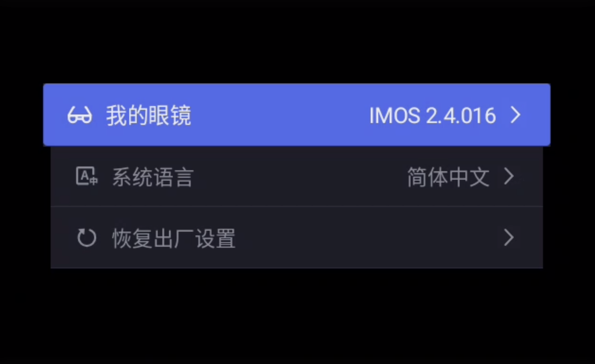
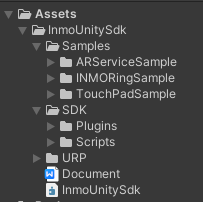
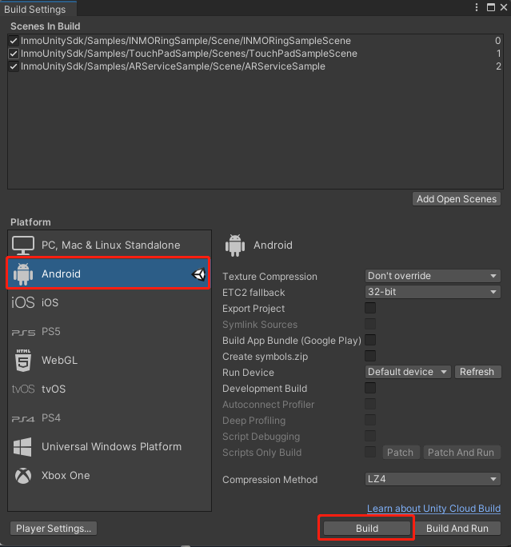
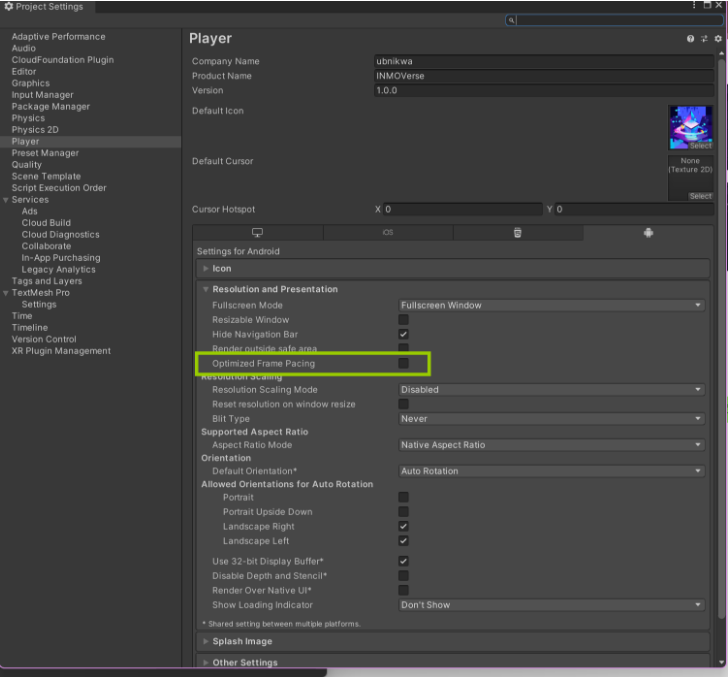
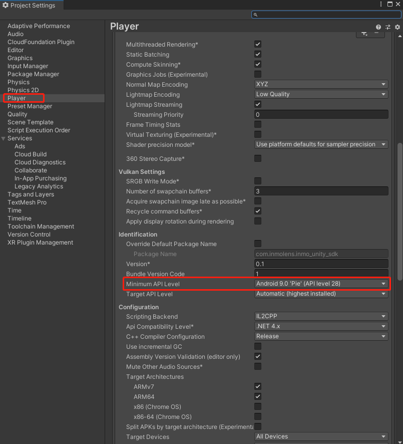

Hi there! I'd love to hear your thoughts. Feel free to leave a [comment](https://github.com/hanlanyi/hanlanyi.github.io/issues), even if it's just a simple 'Hi'.

# 1. INMO Air ADB Activation

## 1. Introduction
Android Debug Bridge (ADB) is a versatile command-line tool that allows you to communicate with a device. ADB commands help with various device operations, such as installing and debugging applications.

Warning: Due to the openness of the Android system, using ADB to install third-party apps and perform any operations on the system's native settings may lead to device lag, overheating, and bugs. We will not be responsible for these issues. Once ADB is enabled, the INMO Air2 will not support returns without reason within seven days.

## 2. Initial Preparation for the Glasses
On this interface, long press the right touchpad twice, each time for 1.5 seconds, and enter the password 20210108 to enable the ADB mode on the glasses.

# 2. Unity SDK
## SDK Function Introduction

This section provides a development guide for the INMO AIR2 SDK on the Unity platform. It includes information on how to adapt development for INMO RING2 on INMO Air2, touchpad interaction development for INMO Air2 AR glasses, and AR capability development kits on the Unity platform.

## Quick Start

### Download the SDK

[INMO SDK](https://github.com/hanlanyi/INMO-Unity-SDK)

### Environment Configuration

#### Software Environment

- Unity Hub and Unity 2020.3LTS or higher, with the Android Support module installed.
- Visual Studio 2019.

To install Unity Hub and Unity Editor, please visit the [Unity Official Website](https://unity.com/).

**How to install Android Support?**

1. Open Unity Hub, click on the installations on the left, select the version that needs Android Support, and click the gear icon.
2. Click Add Modules, find Android Build Support, and click Install. After installation, the Android label will appear under that version.

**Recommended installation of Visual Studio 2019 through the above add modules method.**

**Correspondence between Android NDK and Unity versions:**

| Unity Version | NDK Version |
| ------------- | ----------- |
| 2020.3 LTS    | r19         |
| 2021.3 LTS    | r21d        |

#### Hardware Environment

- INMO AIR2 Glasses
- INMO RING2 Ring

### Import the SDK

The `inmo_unity_sdk` package structure is as follows:

- `Samples`: Examples provided by the SDK.
- `SDK`: AAR library for AR services.
- `URP`: Pipeline configuration. If your project already has URP configuration or uses the Built-in pipeline, you can delete the URP folder.
- `Document`: Offline documentation.
- `InmoUnitySdk`: SDK assembly.

**Import Guide:**

1. Create a new project or open an existing project and switch to the Android platform via `File -> Build Settings`.

2. Download the SDK sample code and import it into the project, or import the latest `unitypackage` provided by the SDK:
   - Drag the `unitypackage` directly into the Project window.
   - Through `Assets -> Import Package -> Custom Package`, click the import button at the bottom right of the page and wait for the compilation to complete.

### Packaging Settings

Since AR services are developed based on `android-28`, you need to configure the Minimum API Level to 28 during packaging. The default Scripting Backend is Mono mode, but Il2Cpp mode is recommended for better performance and scalability. The SDK uses the ARMv7 architecture, so you can uncheck ARM64 in Target Architectures to reduce package size. It is recommended to uncheck the "Optimize Frame Rate" option when packaging, as shown below:

### 3D Model Resource Requirements

#### Recommended Rendering Settings for INMO AIR2 Unity Development

- The tested simultaneous rendering is about 100,000 to 200,000 faces. Models need to be lightweight, reducing the number of faces as much as possible.
- Use only one Directional Light as a dynamic light source; use lightmaps for multiple lights.
- Set the Camera's Render Shadows to off, and the Directional Light's Shadow Type to No Shadows.
- Set the Camera's Field Of View to 13.4, Near to 0.1, and Far to 15.
- Avoid using low-performance shaders, such as Highlight outlines for the entire model, which will double the number of faces rendered.

# Source
1. [INMO Air ADB Activation](https://x0kcf6iksn.feishu.cn/docx/R7q9dxHdao5H0FxjdgScLFKxn3v)
2. [Unity SDK](https://gitee.com/inmolens/docs#unity-sdk)
